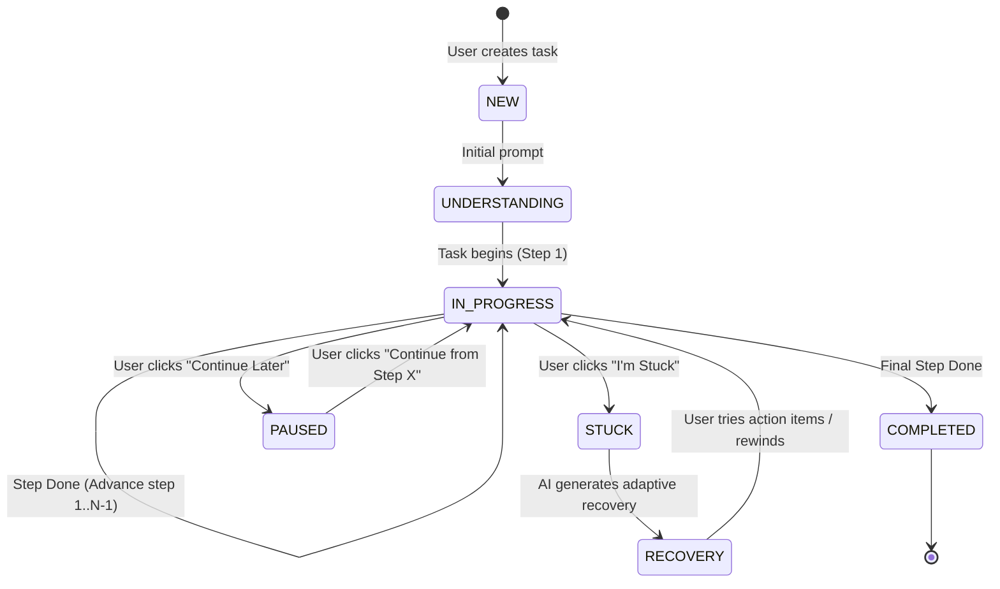

# Digital Life Navigator — System Architecture

> **Tagline:** “Show me what you’re trying to do. I’ll help you do it.”  
> **Core Principle:** Do not teach technology first. Help the person complete the task first.

---

## 1. High-Level Architecture Overview

Digital Life Navigator is designed with a **"Simple Outside, Sophisticated Inside"** philosophy. The frontend presents a calm, uncluttered experience with high readability and few buttons, while the backend hosts a deterministic, authoritative Finite State Machine (FSM) backed by an extensible AI Provider layer (MockProvider for ₹0 local development and BedrockProvider for AWS cloud execution).

```
+--------------------------------------------------------------------------+
|                        USER INTERACTION SURFACES                        |
|                                                                          |
|  [ Web UI: Simple 3 Choices ]       [ Simulated Alexa+ Voice / Audio ]   |
|   - "I want to do something"         - Glowing Alexa Ring Aura           |
|   - "I don't understand this"        - Web Speech Recognition (Mic)      |
|   - "I'm stuck"                      - Browser Speech Synthesis (TTS)    |
+--------------------------------------------------------------------------+
                                    │
                                    ▼ HTTP / JSON REST APIs
+--------------------------------------------------------------------------+
|                     FASTAPI BACKEND SERVICE (PORT 8000)                  |
|                                                                          |
|  API Routes:                                                             |
|   - /health                 System diagnostics & AI engine indicator     |
|   - /tasks                  Catalog, Task Creation, Progression          |
|   - /tasks/{id}/done        Step progression                             |
|   - /tasks/{id}/back        Non-destructive step rewind                  |
|   - /tasks/{id}/stuck       Adaptive recovery guidance                   |
|   - /tasks/{id}/pause       Task pausing ("Continue Later")             |
|   - /tasks/{id}/resume      Zero-data-loss task resumption               |
|   - /tasks/{id}/explain     Non-condescending step explanations          |
|   - /message/explain        Flow A: Message Understanding Engine         |
|   - /assistant/message      Simulated Alexa+ multi-turn dialogue engine  |
+--------------------------------------------------------------------------+
          │                                           │
          ▼                                           ▼
+----------------------------------+   +-----------------------------------+
|     AUTHORITATIVE TASK ENGINE    |   |         AI PROVIDER LAYER         |
|                                  |   |                                   |
|  - Finite State Machine          |   |  AIProvider (Abstract Base Class) |
|  - Event Audit Logging           |   |       ├── MockProvider (₹0 Local) |
|  - Step Tracking & Validation    |   |       └── BedrockProvider (AWS)   |
|  - Synthetic Practice Sandboxes  |   |           - Claude 3 / Nova       |
+----------------------------------+   +-----------------------------------+
          │
          ▼
+--------------------------------------------------------------------------+
|                      SQLITE DATABASE (PERSISTENCE)                       |
|                                                                          |
|  - tasks       (id, title, type, status, current_step, total_steps)      |
|  - task_steps  (id, task_id, step_number, title, instruction, completed) |
|  - task_events (id, task_id, event_type, payload, created_at)            |
+--------------------------------------------------------------------------+
```

---

## 2. Finite State Machine (FSM)

The backend `TaskEngine` is the single source of truth for task progress. Task progression is never left purely to client-side state.



### State Transitions

| From State | Trigger | To State | Action |
| :--- | :--- | :--- | :--- |
| `NEW` | `create_task()` | `IN_PROGRESS` | Instantiates template steps in SQLite, logs `TASK_CREATED` |
| `IN_PROGRESS` | `advance_step()` (current < total) | `IN_PROGRESS` | Marks step completed, advances `current_step` |
| `IN_PROGRESS` | `advance_step()` (current == total)| `COMPLETED` | Marks final step completed, marks status `COMPLETED` |
| `IN_PROGRESS` | `step_back()` | `IN_PROGRESS` | Rewinds `current_step` without destroying task |
| `IN_PROGRESS` | `mark_stuck()` | `STUCK` → `RECOVERY` | Calls AI provider for gentle, tailored recovery instructions |
| `RECOVERY` | user acknowledges recovery | `IN_PROGRESS` | Resumes guided progression |
| `IN_PROGRESS` | `pause_task()` | `PAUSED` | Safely saves exact current step in SQLite |
| `PAUSED` | `resume_task()` | `IN_PROGRESS` | User resumes from saved step without repeating earlier steps |

---

## 3. Core MVP Flows

### Flow A: Understand a Digital Message
* **User Input:** Confusing notification or SMS (e.g., *"You are requested to verify your document before continuing your application"*).
* **Engine Output:**
  * Simple summary & plain meaning.
  * Why it matters in everyday terms.
  * What the user should do next.
  * Critical warnings (What NOT to do: no sharing OTPs, passwords, or rushing).
  * Direct action link: "Help me do this task now", launching Flow B.

### Flow B: Complete an Unfamiliar Digital Procedure
* **Progression:** Guides the user exactly one step at a time.
* **Practice Sandbox:** Every step contains a synthetic interactive element (e.g. simulated input box, file preview, or button click) allowing the user to build tactile confidence without real-world risk.
* **Navigation Controls:** `[Done, Next Step]`, `[I'm Stuck]`, `[Back]`, `[Explain Again]`, `[Continue Later]`.

### Flow C: Get Unstuck & Recover
* When the user clicks `I'm Stuck`, the system offers 5 clear, compassionate categories:
  1. *I don't understand this*
  2. *I don't know where to click*
  3. *I'm not sure what this means*
  4. *I think I made a mistake*
  5. *Show me again / Explain simpler*
* The engine generates an adaptive recovery plan with reassurance, a simplified single action, and an optional safe step rewind.

---

## 4. Multilingual Architecture

The application is structured for clean multilingual localization:
* English (`en`) - Primary
* Hindi (`hi`) - हिन्दी
* Marathi (`mr`) - मराठी

Both the frontend UI labels (`translations.ts`) and backend AI explanations provide native responses in the selected language.

---

## 5. Security & Safety Principles

1. **₹0 Base Cost:** Default execution uses `MockProvider` requiring zero API keys and zero paid cloud services.
2. **Safe Demo Data Only:** Synthetic tasks, no integration with live banking, OTPs, or government portals.
3. **No Secrets in Source:** Secrets configured strictly via server-side environment variables (`.env`).
4. **Resilient Fallback:** If cloud AI (Amazon Bedrock) credentials are invalid or unavailable, the system automatically falls back to `MockProvider` without interrupting user workflow.
